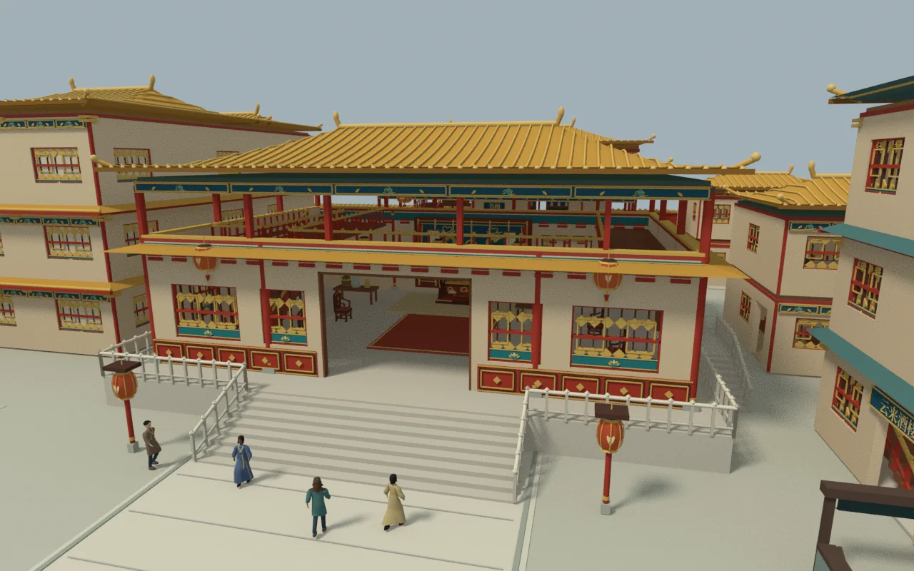
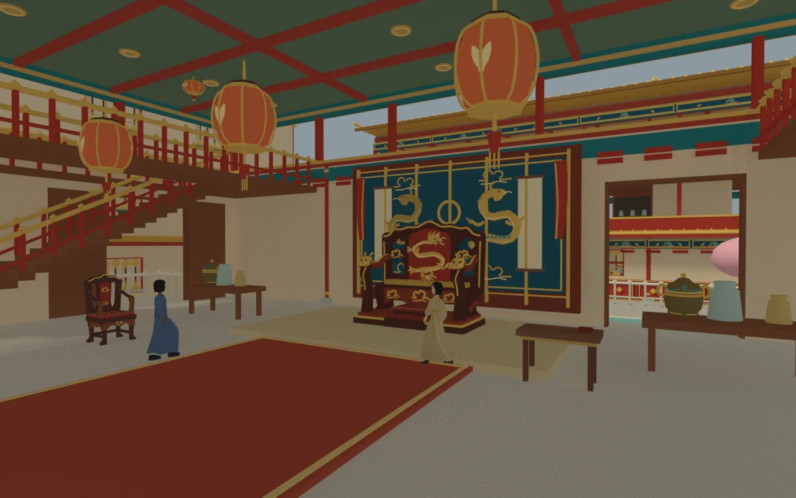
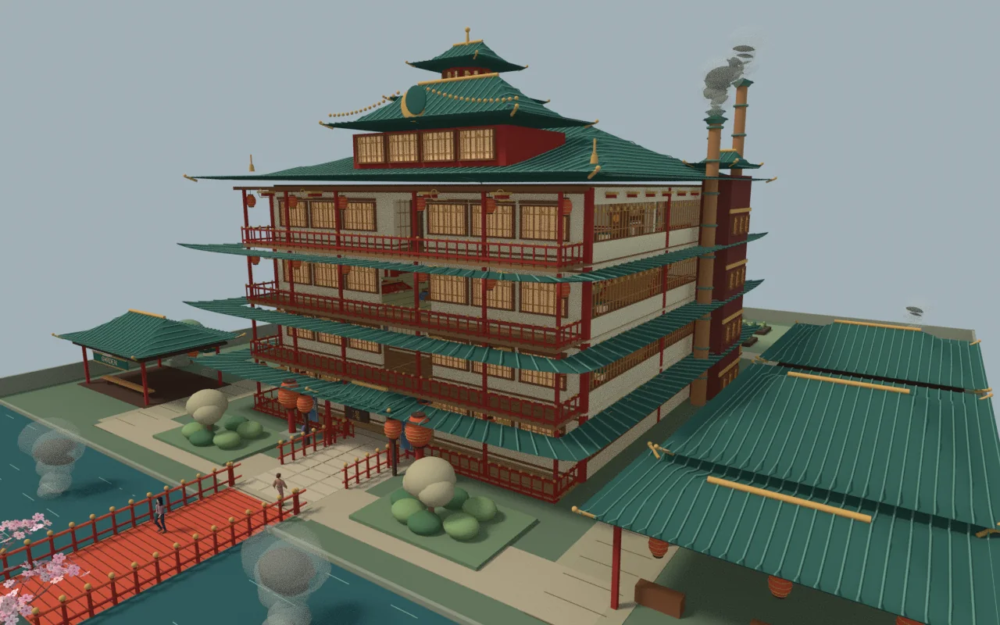
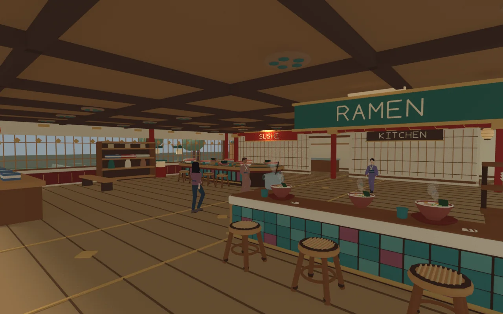
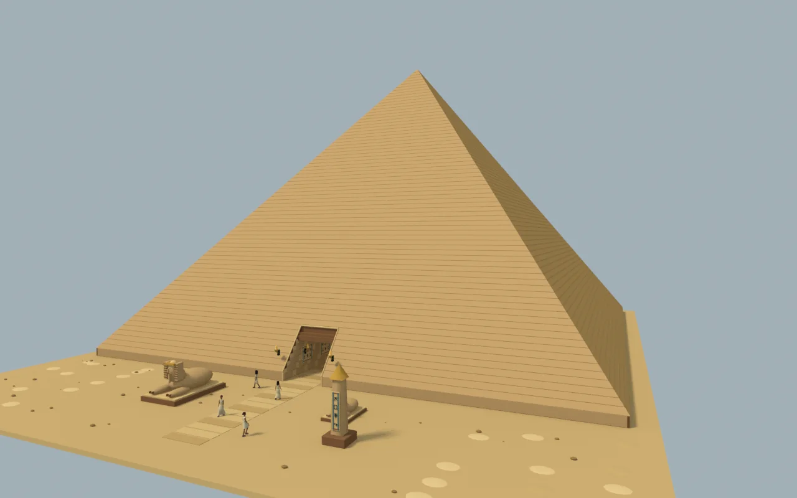
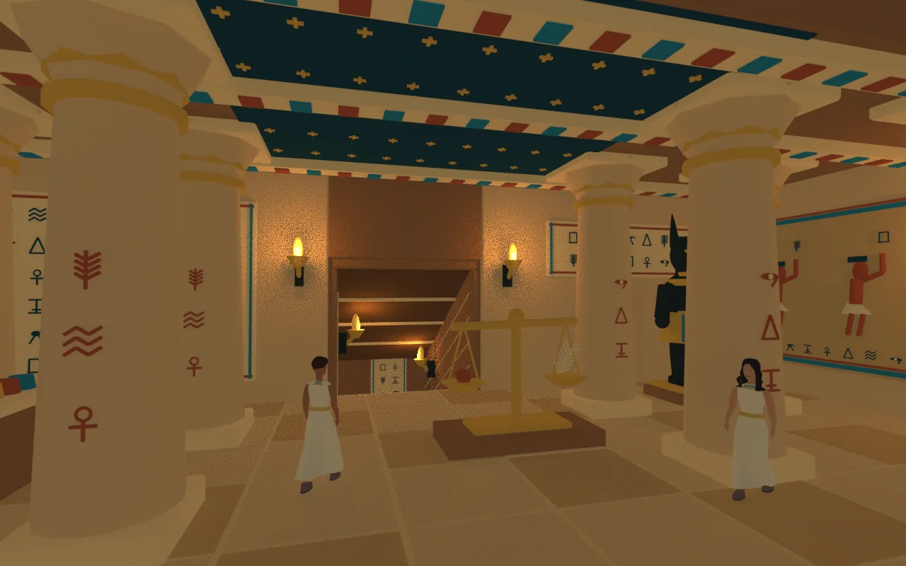
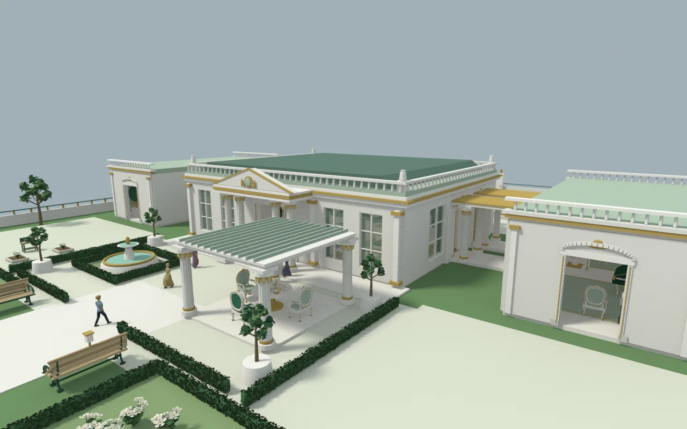
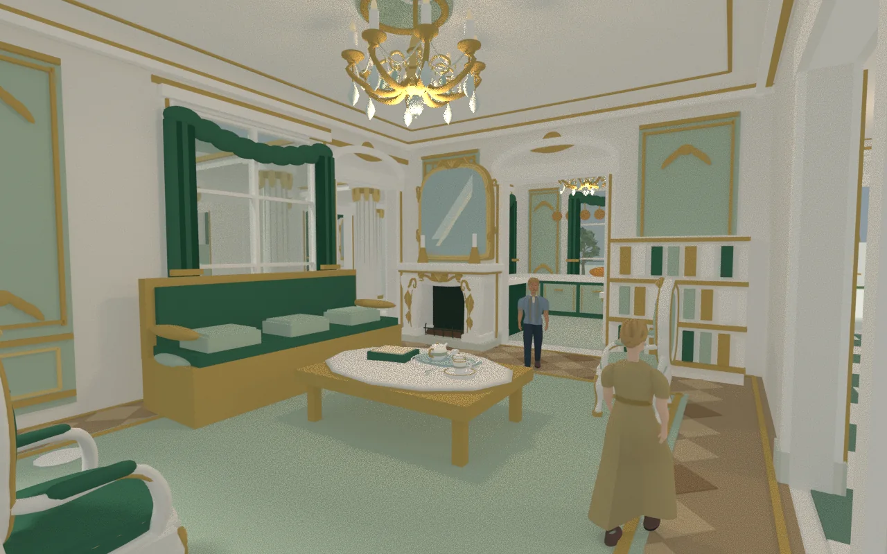

<div align="center">

# Worldwoven

### Four places. Everyday stories.

Wander beneath lanterns, through palace courtyards, into painted temples, and along quiet garden paths.

**[Play in your browser ↗](https://alien.doudouai.net/)** · [Explore the worlds](#explore-the-worlds) · [Run locally](#run-locally) · [Documentation](#documentation)

3D exploration · Everyday life · Distinct cultural settings · Procedural worlds

<sub>四方生活 · A small world to make yourself at home in.</sub>

</div>

## A different kind of day

**Worldwoven** is a stylized, single-player life and exploration game for the browser. Spin the globe, choose a destination, and step into a place with furnished rooms, connected stairways, local residents, and its own daily rhythms.

Take a walk. Stop for tea. Read, change outfits, visit a bathhouse, or try an available local job. Each region brings together distinctive architecture and everyday activities within an original fictional setting.

## Explore the worlds

### China · Palace courtyards

Golden roofs, vermilion columns, and layered courtyards surround a ceremonial hall. Beyond the central avenue, explore a tavern, study rooms, tea gatherings, and the working life of the palace.

<table>
<tr><th width="50%">Exterior · Along the palace avenue</th><th width="50%">Interior · The ceremonial hall</th></tr>
<tr>
<td><a href="docs/images/china-exterior.webp"></a></td>
<td><a href="docs/images/china-interior.webp"></a></td>
</tr>
</table>

### Japan · Lantern bathhouse

A four-storey timber bathhouse rises above a canal and vermilion bridge. Follow its real stairways from the lantern-lit food hall to hot springs, warm kotatsu tables, performance spaces, and upper galleries.

<table>
<tr><th width="50%">Exterior · Across the canal bridge</th><th width="50%">Interior · The lantern food hall</th></tr>
<tr>
<td><a href="docs/images/japan-exterior.webp"></a></td>
<td><a href="docs/images/japan-interior.webp"></a></td>
</tr>
</table>

### Egypt · A world inside the pyramid

Walk past weathered guardians and into a monumental pyramid. Painted columns, a star-patterned ceiling, an upper throne room, and underground chambers share space with kitchens, workshops, and archives.

<table>
<tr><th width="50%">Exterior · The desert approach</th><th width="50%">Interior · The painted column hall</th></tr>
<tr>
<td><a href="docs/images/egypt-exterior.webp"></a></td>
<td><a href="docs/images/egypt-interior.webp"></a></td>
</tr>
</table>

### France · A garden palace

Ivory walls, soft greens, and gilded details frame connected salons and symmetrical gardens. Discover tea service, pastries, gardening, and painting in a palace built for an unhurried afternoon.

<table>
<tr><th width="50%">Exterior · The garden promenade</th><th width="50%">Interior · The emerald salon</th></tr>
<tr>
<td><a href="docs/images/france-exterior.webp"></a></td>
<td><a href="docs/images/france-interior.webp"></a></td>
</tr>
</table>

<sub>Click any image for a larger view. These are offline previews of the actual game geometry and character models, with illustrative lighting and varied walking poses. They are not captured gameplay screenshots. [Image provenance and presentation notes](docs/images/README.md)</sub>

## Make yourself at home

- **Explore connected spaces.** Move between interiors, courtyards, corridors, and stairs in a close third-person view, or switch to an overview of the region.
- **Enjoy everyday activities.** Use interactive seating, beds, and baths; share in local food and tea services; read and customize your character’s appearance and clothing.
- **Meet the residents.** Characters have their own identities, appearances, jobs, and routines, with supported conversations, meetings, and relationship events.
- **Take on real tasks.** Available jobs connect application and work to local services such as hospitality, cooking, gardening, and record-keeping. Cash, bank balances, and wages are tracked separately.
- **Continue your journey.** Choose another region from the world map, consult your travel passport, and return to progress saved in the same browser.

This is an experimental playable world. Feature coverage varies across regions and roles; a complete life simulation, every career workflow, and broad device compatibility are not yet established. The [project checklist](docs/PROJECT_CHECKLIST.md) and [career coverage notes](docs/CAREER_COVERAGE.md) document the current boundaries and known issues.

## Controls

**Desktop**

- `W A S D` or arrow keys to move; `Shift` to walk faster
- Click the ground to walk to a destination
- Drag an empty part of the view to rotate the camera; scroll to zoom
- Approach a resident or object and click its interaction marker, or press `E`

**Phone and tablet**

- Landscape orientation is recommended
- Use the lower-left joystick to move, drag to rotate, and pinch to zoom
- Tap the interaction markers near residents and objects

**Saving:** Progress is stored locally in your browser, without cloud-account synchronization. Clearing site data or switching browsers or devices may make an existing save unavailable.

## Run locally

Requires **Node.js 22+** and npm. The project uses native ES modules. Three.js is vendored in the repository, with no additional runtime or build packages to download.

```bash
git clone https://github.com/ChloisHuang/worldwoven.git
cd worldwoven
npm ci
npm run dev
```

Open **http://127.0.0.1:5173/**.

```bash
# Generate content-hashed production assets
npm run build

```

The development server binds to `127.0.0.1`. Build output is written to `dist/`; building does not publish the site.

## Under the hood

**JavaScript · Three.js r186 · WebGL · HTML / CSS · Node.js**

Architecture, furniture, and many environmental details are constructed with procedural geometry. The interface uses native HTML and CSS, while the development server and build pipeline use Node.js built-ins.

```text
source/
  game/           Scenes, characters, interactions, careers, and life systems
  vendor/three/   Three.js renderer and its license
  licenses/       Third-party asset provenance and licenses
scripts/          Local development, build, and preview helpers
worker/           Supporting site Worker
docs/             Project documentation and gallery images
```

## Documentation

Detailed project notes are currently written primarily in Chinese.

- [Project checklist](docs/PROJECT_CHECKLIST.md): implemented scope, known issues, and unfinished work
- [Career coverage](docs/CAREER_COVERAGE.md): regional roles and their actual integration
- [Wallet and accounts](docs/WALLET.md): in-game cash, banking, and related interactions
- [Cultural life systems](docs/research/cultural-life-systems.md): design background and research
- [Contributor working agreement](AGENTS.md): repository collaboration conventions

Some documents retain historical release records. Removed test commands and evidence paths in those records are not current entry points.

## Credits and licensing

- **Three.js** is provided under the [MIT License](source/vendor/three/LICENSE).
- **MakeHuman / MPFB base human mesh:** CC0 graphical data. See the [asset provenance](source/licenses/complete-adult/provenance.json), [upstream license](source/licenses/complete-adult/UPSTREAM-LICENSE.md), and [CC0 1.0 text](source/licenses/complete-adult/CC0-1.0.md).
- Buildings, furniture, and cultural environments use original procedural geometry. No EA game or player-mod assets were imported.

The project’s own code and original assets do not currently carry a blanket open-source license. Third-party components and assets remain subject to their respective licenses.

<div align="center">

**[Find somewhere new to spend an ordinary day.](https://alien.doudouai.net/)**

</div>
