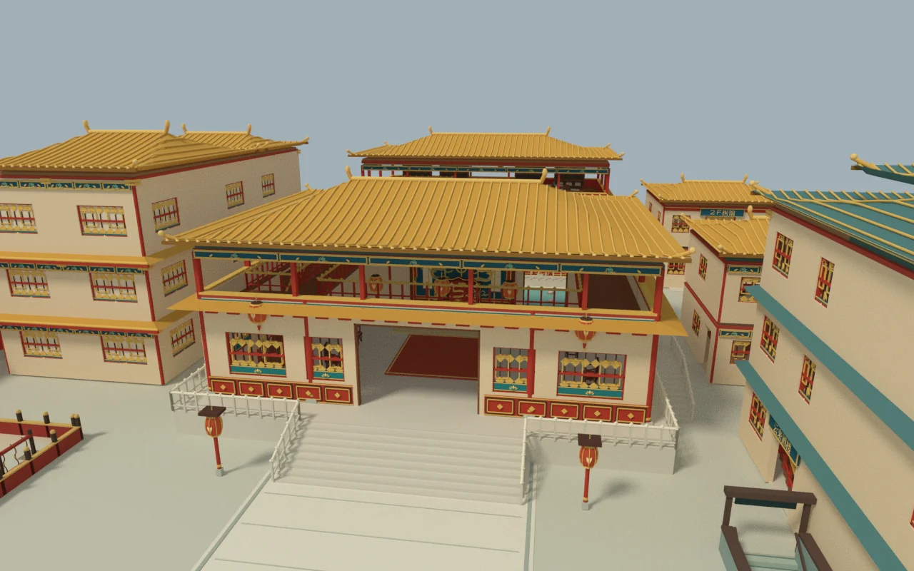
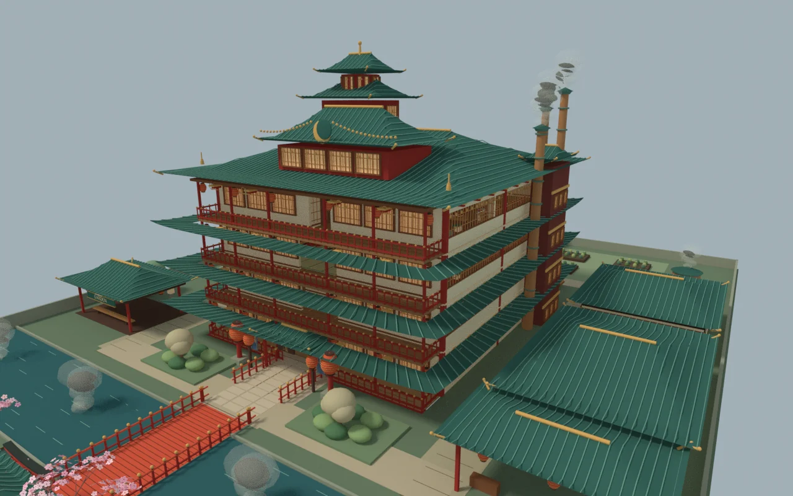
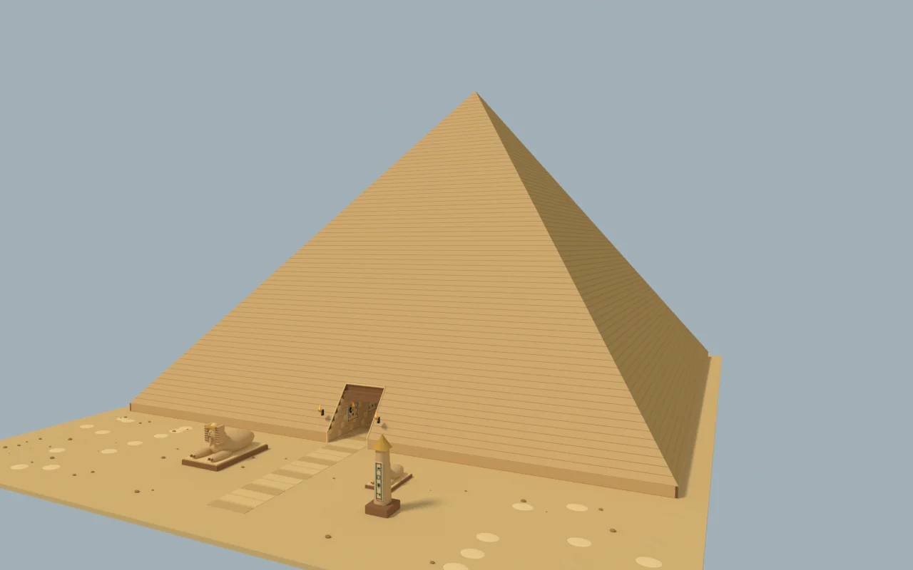
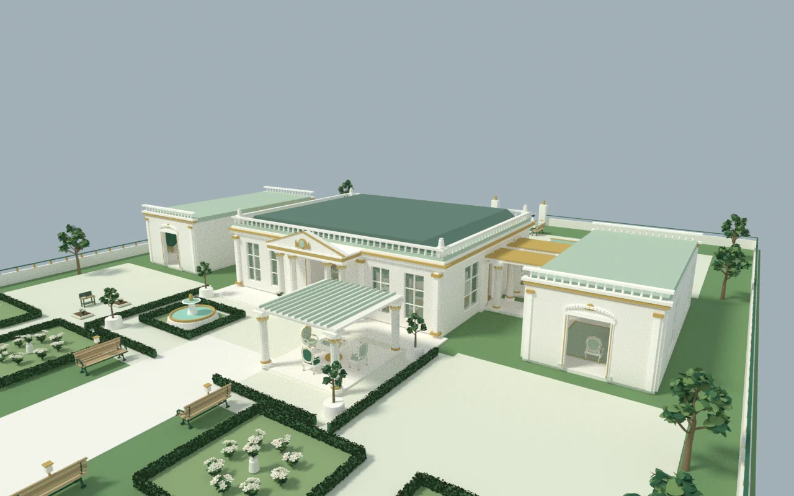

<div align="center">

# 四方生活 · Worldwoven

### 一颗星球，四种日常。

在樱花与温泉、宫苑与茶席、沙海与神殿、花园与王宫之间，过一段自己的生活。

*A browser-based 3D world of cultural spaces, everyday life, and exploration.*

**[开始旅居 ↗](https://alien.doudouai.net/)** · [四国一览](#四国一览) · [本地运行](#本地运行) · [项目文档](#项目文档)

浏览器 3D · 第三人称探索 · 生活互动 · 原创程序化场景

</div>

## 今天，住在哪里？

**四方生活**是一款风格化的单人生活探索游戏。转动地球，选择一个目的地，走进有屋顶、有楼梯、有居民生活的空间：散步、用餐、泡汤、读书、换装，也可以在当地寻找工作，参与一段日常。

四个地区拥有各自的建筑、设施与居民。这里的文化与职业设定服务于虚构世界，采用艺术化表达。

## 四国一览

<table>
<tr>
<td width="50%" valign="top">
<h3>🇨🇳 中国 · 承光宫苑</h3>
<a href="docs/images/china.webp"></a>
<p>穿过赤柱金瓦与重重庭院，在宫廷、酒楼、书房和茶席之间探索。朝班、文书与各处生活服务，让宫苑有了日常的节奏。</p>
</td>
<td width="50%" valign="top">
<h3>🇯🇵 日本 · 云隐汤馆</h3>
<a href="docs/images/japan.webp"></a>
<p>沿真实楼梯走过四层汤馆，从寿司与拉面大厅，到温泉、暖桌、演艺茶席与望景廊，发现灯笼与木作之间的小小生活。</p>
</td>
</tr>
<tr>
<td width="50%" valign="top">
<h3>🇪🇬 埃及 · 沙海金字塔</h3>
<a href="docs/images/egypt.webp"></a>
<p>从沙海与石像走入金字塔，探索彩绘柱厅、上层王殿与地下墓室，也能接触接待、厨房、工坊和档案室里的事务。</p>
</td>
<td width="50%" valign="top">
<h3>🇫🇷 法国 · 白鸢王宫</h3>
<a href="docs/images/france.webp"></a>
<p>在象牙白、翠绿与鎏金之间漫步，穿过连贯套间与对称花园，体验茶会、糕点、园艺和绘画的悠闲日常。</p>
</td>
</tr>
</table>

<sub>配图由当前源码中的真实场景几何离线渲染，使用示意日光；展示建筑与布局，不是浏览器实机截图。游戏中的人物、界面与实时光影以在线体验为准。[配图说明](docs/images/README.md)</sub>

## 在这里，可以做什么

- **走进建筑，而不只停在门外**：近距离跟随人物，穿过门廊、室内、庭院与楼梯；也可以切换俯瞰，看看整个地区。
- **参与当地的日常**：使用可互动的座椅、寝具与浴池，享用餐食，读书学习，选择人物外观与服装。
- **和居民相遇**：居民拥有自己的身份、外观、岗位和生活安排；靠近交谈，参与已接入的会面与关系事件。
- **用实际工作获得收入**：在已开放的岗位申请任职，完成接待、餐饮、园艺、文书等职责；工资、现金与银行账户分别记录。
- **把旅程继续下去**：通过世界地图选择地区，用旅行护照查看旅居信息；人物与世界进度保存在当前浏览器中。

各地区和岗位的完成度不同。当前版本仍有已知问题，完整人生模拟、全部职业流程和跨设备体验尚未完成；具体范围见[问题与需求清单](docs/PROJECT_CHECKLIST.md)与[职业覆盖说明](docs/CAREER_COVERAGE.md)。

## 怎么玩

**电脑**

- `W A S D` / 方向键移动，`Shift` 加快脚步；也可以点击地面走过去
- 拖动空白处转动视角，滚轮缩放
- 靠近居民或物件，点击互动标记，或按 `E` 体验附近活动

**手机 / 平板**

- 建议横屏游玩，使用左下摇杆移动
- 滑动画面转动视角，双指缩放，点击画面中的互动标记

**存档提示**：进度保存在浏览器本地，不提供云端账号同步。清理站点数据、更换浏览器或设备可能无法继续原存档。

## 本地运行

需要 **Node.js 22+** 与 npm。项目使用原生 ES Modules，Three.js 已随仓库提供，无需下载额外的运行或构建依赖。

```bash
git clone https://github.com/ChloisHuang/worldwoven.git
cd worldwoven
npm ci
npm run dev
```

打开 **http://127.0.0.1:5173/**，即可进入本地游戏。

```bash
# 生成带内容哈希的生产资源
npm run build

# 在本地查看生产构建
npm run preview
```

生产预览地址为 **http://127.0.0.1:4173/**。本地服务器仅监听 `127.0.0.1`；构建输出位于 `dist/`，构建命令不会自动发布站点。

## 技术与结构

**JavaScript · Three.js r186 · WebGL · HTML / CSS · Node.js**

建筑、家具与大量场景细节由程序几何构建。界面使用原生 HTML / CSS，开发服务器和构建脚本使用 Node.js 内置模块。

```text
source/
  game/           场景、人物、交互、职业与生活系统
  vendor/three/   Three.js 渲染器及其许可证
  licenses/       第三方素材的来源与许可
scripts/          本地开发、构建和预览
worker/           站点配套 Worker
docs/             项目说明与配图
```

## 项目文档

- [问题与需求清单](docs/PROJECT_CHECKLIST.md)：已有功能的边界、已知问题与待完成内容
- [职业覆盖说明](docs/CAREER_COVERAGE.md)：各地区岗位与实际接入范围
- [钱包与账户](docs/WALLET.md)：游戏内现金、银行与相关交互
- [文化与生活系统设计](docs/research/cultural-life-systems.md)：设计背景与研究记录
- [协作约定](AGENTS.md)：修改仓库时遵循的工作规则

部分文档保留了历史版本记录，其中已移除的测试命令与证据路径不再作为当前运行入口。

## 致谢与许可

- **Three.js**：遵循 [MIT License](source/vendor/three/LICENSE)。
- **MakeHuman / MPFB 基础人体网格**：使用 CC0 图形数据，详见[素材来源](source/licenses/complete-adult/provenance.json)、[上游许可](source/licenses/complete-adult/UPSTREAM-LICENSE.md)与 [CC0 1.0](source/licenses/complete-adult/CC0-1.0.md)。
- 建筑、家具与文化场景采用原创程序几何；未导入 EA 游戏或玩家模组资产。

项目代码与原创素材尚未附统一开源许可证；第三方组件与素材分别遵循其对应许可。

<div align="center">

**[去另一个地方，过一会儿日常。](https://alien.doudouai.net/)**

</div>
